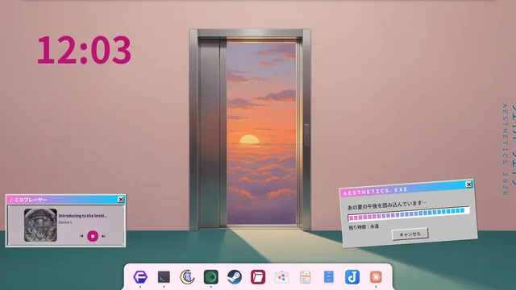
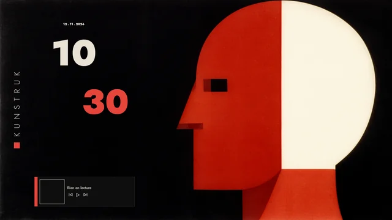
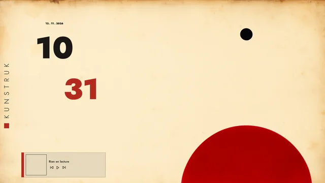
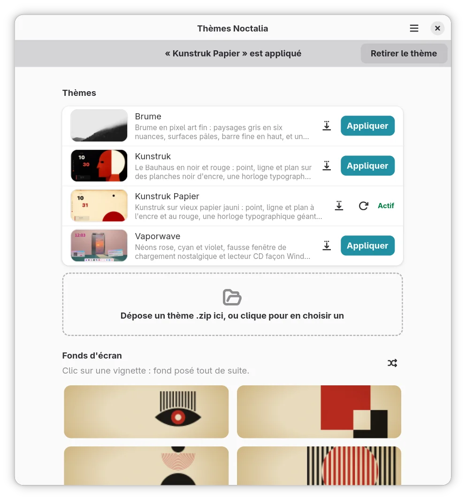

# noctalia-themes

**Whole-desktop themes for [Noctalia](https://docs.noctalia.dev/noctalia/) v5 — one click to dress your desktop,
one click to get it back exactly as it was.**

Not just a color scheme: each theme brings its own wallpapers, bar, dock, fonts, desktop widgets (a music player
with cover art, a clock) and even the login screen. The app saves your setup before every change, so trying a theme
costs nothing.

[](https://github.com/pirona/noctalia-themes/releases/latest)
[](LICENSE)
[](https://ko-fi.com/billisdead)

| | |
|:-:|:-:|
|  |  |
| **Vaporwave** — pink, cyan and violet neon, a fake loading window, a CD player straight out of 1998 | **Brume** — grey fog in fine pixel art, six shades of quiet, a thin bar on top |
|  |  |
| **Kunstruk** — Bauhaus in ink black and red: point, line and plane, a giant typographic clock, the bar standing on the right edge | **Kunstruk Papier** — the same on old yellowed paper, with a round dock at the top |

<p align="center"></p>

- **Safe by design**: timestamped backup before each apply, rollback if anything fails, an “Undo” toast, and
  “Remove the theme” puts your own desktop back.
- **Share themes**: export any theme as a `.zip`, import one by drag and drop, or turn your current desktop into a
  theme.
- **Per-user, no `sudo`**: one `./install.sh`, one `./install.sh --uninstall`.
- English interface, French translation picked from your locale. Tested on Noctalia 5.3.0 with niri.
  License: GPL-3.0-or-later.

If these themes brighten your desktop, you can buy me a coffee on **[Ko-fi](https://ko-fi.com/billisdead)** ☕
— it keeps new themes coming.

## Install

Download `noctalia-themes-<version>.tar.gz` from the [latest release](https://github.com/pirona/noctalia-themes/releases/latest),
then:

```bash
sha256sum -c noctalia-themes-*.tar.gz.sha256   # expected: OK
tar xf noctalia-themes-*.tar.gz
cd noctalia-themes-*/
./install.sh
```

Or from a clone (`git clone https://github.com/pirona/noctalia-themes.git`), which follows `main` instead of releases.
Changes per version: [CHANGELOG.md](CHANGELOG.md).

`install.sh` checks that Python 3.11+, PyGObject, GTK 4.12+ and libadwaita 1.5+ are importable (it prints the
package command for Fedora, Debian/Ubuntu and Arch otherwise). It then copies the app, its themes and plugin to
`~/.local/share/noctalia-themes/app/`, so the clone can move or go, and adds:

- a `noctalia-themes` command in `~/.local/bin/`;
- a launcher entry with its icon (`~/.local/share/applications/`, `~/.local/share/icons/hicolor/`);
- an AppStream entry (`~/.local/share/metainfo/`), read by software centers.

It also notes what is missing but optional: Noctalia older than 5.3, `playerctl` (the themes' music player stays
empty without it), `pkexec` when Noctalia Greeter is installed, and `msgfmt` (the app is then in English only).
It never uses `sudo`. Run it again after a `git pull` to update: the new copy replaces the old one in one move.

`./install.sh --uninstall` removes the app, the command, the launcher, the icon and the AppStream entry. Backups,
imported themes and preferences are kept; a theme still applied stays applied, so remove it from the app first.

Start “Noctalia Themes” from the launcher, run `noctalia-themes`, or `python3 app/main.py` from the clone.

## Use

- **Apply**: button on the theme's row, after confirmation. A toast offers “Undo” for 8 s.
- **Add a theme**: drop its `.zip` on the dashed field (see [Add a theme](#add-a-theme)); the trash on an
  imported theme removes it from the list.
- **Export a theme**: the save icon on any theme's row writes it as a `.zip` to share; the app runs the import
  checks first and lists what to fix if they fail.
- **Create a theme from my desktop** (menu, Ctrl+N): copies the palette, the wallpaper on screen, the looks of the
  bar and dock, and the desktop widgets with their stickers into a new imported theme, ready to export. Left out, and
  listed: the bar's widget layout, pinned dock apps, third-party plugin widgets, anything that runs a program.
- **Remove**: the banner at the top as soon as a theme is active, one click. The configuration from before the theme
  comes back **with the settings you changed meanwhile** (bar, dock, plugins…); only the theme's own settings leave
  with it (keys it sets, its widgets, a wallpaper from its folder). If you changed some of the theme's own settings,
  the app lists them first. Switching straight from one theme to another works the same way.
- **Save my setup** (menu, Ctrl+S): copies all of Noctalia as is (config, `settings.toml`, active theme, widget
  positions, fonts, wallpaper). Restoring it brings everything back; these backups are never pruned automatically.
- **Wallpapers**: gallery of the active theme's wallpapers; click to set one, 🔀 for a random one.
- **Update** (⟳ on the active theme): reinstalls stickers, palette and widgets without touching your settings.
- **Backups**: dated list. “Restore” brings Noctalia back to that date, wallpaper included; the trash deletes a
  backup after confirmation (never the active theme's, its only way back).
- **Widget groups stay together**: a theme groups widgets that form one visual unit (e.g. a sticker and a
  label). Noctalia's widget editor moves widgets one by one; when you close it, the app (if it is open)
  moves the rest of the group by the same offset. It also does it when its window gets the focus back.

### Preferences (menu → Preferences, or Ctrl+,)

| Page | Settings |
|---|---|
| Wallpapers | transition effects (11), duration, fill mode |
| Widgets | show/hide each widget group, dark/light/auto mode, clock 12 h / seconds / color, player (hide when nothing plays) |
| App | confirm before applying, login screen follows the theme (only shown when Noctalia Greeter is installed), target screen, number of backups to keep + clean-up (confirmed, never the active theme's) |
| Diagnostic | versions, active theme, screen, changed or overridden settings, paths, log tail, copy to clipboard |

A preference left on “like the theme” writes nothing. Invalid values in the preferences file fall back to defaults.

**Login screen.** With [Noctalia Greeter](https://github.com/noctalia-dev/noctalia-greeter) installed, the app sets
`[shell.greeter_sync] auto_sync = true` while a theme is active, so Noctalia copies the wallpaper, colors, mode and
shell font to the login screen on every change. When a theme leaves, the app runs one `noctalia msg greeter-sync`
(its options leave with it). Each sync asks for an administrator password unless you allow it once with the
greeter's own narrow Polkit rule: `sudo noctalia-greeter passwordless-sync enable "$USER"`. The login screen is the
same for every account of the machine.

A theme can pick its own login wallpaper (`login_wallpaper` in `theme.toml`, e.g. a calmer image than the desktop's).
Then the app turns `auto_sync` off while the theme is active, and on apply or refresh writes what the greeter
expects into `/run/user/<uid>/noctalia-greeter-sync/` (the theme's colors and mode, plus that wallpaper) and hands it
to the greeter's helper, `pkexec noctalia-greeter-apply-appearance --sync`, the same path and Polkit rule Noctalia
uses. Changing the desktop wallpaper then leaves the login screen alone. The shell font is not copied this way.

## How it works

Noctalia loads its layers in this order, the last one wins:

1. its defaults;
2. `~/.config/noctalia/*.toml`, **in alphabetical order**: `zz-theme.toml` (the theme), then
   `zzz-theme-options.toml` (the app's preferences, which therefore win over the theme);
3. `~/.local/state/noctalia/settings.toml`, written by Noctalia's own settings UI, which wins over everything.

A theme dropped in `~/.config` would be hidden by the state file. So applying a theme:

1. validates it (palette, `theme.toml`, readable TOML): nothing is touched if it is invalid;
2. removes the active theme first, if any, so the backup always captures the original state;
3. backs up `settings.toml`, every file about to be overwritten and the current wallpaper;
4. copies the theme to its installed place, the palette to `palettes/`, the fragment to `zz-theme.toml`, the
   preferences to `zzz-theme-options.toml`;
5. removes from `settings.toml` the keys the theme sets, and the whole `[desktop_widgets]` table.

If a step fails after the backup, everything is restored. Writes are atomic (temporary file, then rename), so
Noctalia, which watches these files, never reads a half-written one. Noctalia reloads them live.

When no setting needs carrying over, removing a theme restores `settings.toml` byte for byte. Otherwise it is
rewritten with the same content in a different layout (arrays of tables become inline tables).

### Files and folders

| Path | Owner | What |
|---|---|---|
| `~/.config/noctalia/zz-theme.toml`, `zzz-theme-options.toml`, `palettes/<name>.json` | Noctalia, written by the app | the active theme and preferences |
| `~/.local/state/noctalia/settings.toml` | Noctalia | read; theme keys removed on apply, widget positions adjusted by the group glue |
| `~/.local/share/noctalia-themes/` | the app, **0700** | installed theme copies, `library/` (imported themes), `backups/`, `current`, `glue.json`, `app.log` |
| `~/.local/share/fonts/noctalia-themes/` | the app | theme fonts (fontconfig must see them) |
| `~/.local/share/noctalia/plugins/theme-widgets/` | Noctalia, written by the app | the player and clock plugin, when the theme uses it (a symlink there is left alone: developer checkout) |
| `~/.config/noctalia-themes/settings.json` | the app, **0700** folder | app preferences |

Each base folder follows XDG and can be overridden: `NOCTALIA_CONFIG_HOME`, `NOCTALIA_STATE_HOME`, `NOCTALIA_DATA_HOME`,
`NOCTALIA_THEMES_HOME`, `NOCTALIA_THEMES_FONTS`, `NOCTALIA_THEMES_CONFIG` (all defined in `app/paths.py`).
`NOCTALIA_THEMES_OUTPUT` forces the screen the widgets go to.

### Security

- No `sudo`, no network access from the app, nothing outside the folders above.
- Backups hold copies of `settings.toml`, which may contain tokens (calendar accounts, plugins): the app's data
  folder is owner-only (0700), and so is its preferences folder.
- Folders are created when first written to, never at start-up.
- Every TOML file is parsed before it is written; a theme's palette name is restricted to `[A-Za-z0-9_-]+` and the
  screen name is escaped, so a theme cannot write outside its place.
- Log: `~/.local/share/noctalia-themes/app.log` (rotated at 200 KB): applies, restores, deletions, wallpaper changes.

## Add a theme

Drag a theme package (`.zip`) onto the dashed field under the theme list, or click the field to pick one. To make
one, see **[Making a theme](docs/THEMES.md)**: folder layout, `app/package.py new | check | pack`, and the rules an
imported theme must follow (looks only: no commands, no files outside the theme). New to packaging? **[Packaging a theme, from A
to Z](docs/PACKAGING.md)** ([en français](docs/PACKAGING.fr.md)) walks through it step by step.

## Generate wallpapers with ComfyUI

Optional: only needed to make new wallpapers. Requires a [ComfyUI](https://www.comfy.org/) server (local or on your
network) with the Flux.2 Dev files: diffusion model `flux2_dev_fp8mixed`, text encoder `mistral_3_small_flux2_fp8`,
VAE `flux2-vae`.

**Configure once**, in one command:

```bash
python3 tools/comfy_generate.py --setup
```

It asks for the server address (Enter keeps `http://127.0.0.1:8188`), checks that the server answers, lists the model
files it offers and proposes the right ones (Enter accepts). Everything goes to **`~/.config/noctalia-themes/comfyui.toml`**:

```toml
url = "http://127.0.0.1:8188"
unet = "flux2_dev_fp8mixed.safetensors"
clip = "mistral_3_small_flux2_fp8.safetensors"
vae = "flux2-vae.safetensors"
```

Edit it by hand or run `--setup` again. `COMFY_URL` overrides the address for one run. Without the file, these
defaults are used, and a model stored in a subfolder on the server (e.g. `FLUX2/flux2_dev_fp8mixed.safetensors`) is
found by its file name. If the server does not answer or a model is missing, the tool says so and points to `--setup`.

**Generate and promote**:

```bash
python3 tools/comfy_generate.py --theme vaporwave --prompt-file tools/prompts/vaporwave/01-atrium.txt \
    --seed 20111209 --name atrium       # one job; waits its turn, never cancels anything; --dry-run prints the graph
python3 tools/promote_wallpaper.py --theme vaporwave <render.png> atrium
```

Renders land in `<Pictures>/noctalia-<theme>-renders/` (`WALLPAPER_BUFFER` to change). Promotion trims a frame drawn
by the model, crops to 1920×1080, converts to WebP, updates `SOURCES.md` and copies the file to
`<Pictures>/wallpapers/<theme>/` (`WALLPAPER_DIR` to change). Prompt rules per theme: `tools/prompts/<theme>/RULES.md`.

## Command line

```bash
python3 app/installer.py apply themes/vaporwave   # prints the backup id
python3 app/installer.py list                     # available backups
python3 app/installer.py rollback <id>            # back to that backup
python3 app/installer.py refresh themes/vaporwave # update the active theme in place, your settings untouched
python3 app/installer.py save                     # save my setup
python3 app/installer.py glue                     # move widget groups back together
```

## Development

```bash
python3 app/palette.py           # color format + contrast >= 4.5:1 (Noctalia silently ignores a bad color)
python3 app/options.py           # preferences: overrides, clock format, TOML keys, validation
python3 tests/test_installer.py  # sandbox: round trip, invalid theme, failure, path tricks, screen, carried
                                 # settings, setup backup, preferences, clean-up, glue, wallpaper, permissions
python3 tests/test_package.py    # theme packages: pack, import, replace, remove, and every refused trap
python3 tests/test_capture.py    # create from the desktop: what comes along, what is left out, a real theme round trip
python3 tests/test_install.py    # install.sh in a temporary HOME: install twice, the copy's paths, uninstall
python3 tests/test_promote_bw.py # black and white thresholding
python3 tests/test_slice_frame.py # player frames rebuild pixel for pixel from their bands
pipx run ruff==0.12.0 check .    # lint + PEP 8 (config in pyproject.toml)
```

Layout: `app/paths.py` (every path), `app/i18n.py` (translations), `app/installer.py` (logic, no GTK, testable),
`app/options.py` (preferences → TOML fragment), `app/package.py` (theme packages + CLI), `app/capture.py` (create a theme from the desktop), `app/window.py` (main window), `app/preferences.py` (preferences
dialog), `app/main.py` (application, actions, shortcuts), `app/palette.py` (palette validation), `data/`
(icon, AppStream metainfo).

Translations: strings are English in the code, wrapped in `_()`. After changing them:

```bash
xgettext -L Python --from-code=UTF-8 -k_ -kngettext:1,2 --add-comments=Translators --no-wrap \
    --package-name=noctalia-themes -o po/noctalia-themes.pot app/*.py
msgmerge -q --no-wrap -U po/fr.po po/noctalia-themes.pot   # then translate the new or fuzzy entries
./install.sh                                                # rebuilds app/locale/
```

A new language is a new `po/<lang>.po` (`msginit -i po/noctalia-themes.pot -l <lang> -o po/<lang>.po`).

### Release

Versions follow [SemVer](https://semver.org/) (see [CHANGELOG.md](CHANGELOG.md)). To release `X.Y.Z`, in one PR set
`VERSION` in `app/main.py`, add `<release version="X.Y.Z" date="…"/>` on top of the metainfo `<releases>` and a
`## [X.Y.Z] - date` section to `CHANGELOG.md`. Once merged, from `main`:

```bash
git switch main && git pull
tools/release.sh X.Y.Z
```

The script checks that `VERSION`, the metainfo and the changelog agree (and stops before pushing anything if not),
tags `vX.Y.Z`, pushes the tag, then publishes the Gitea release (Gitea does not mirror releases) with
`noctalia-themes-X.Y.Z.tar.gz` (`git archive` of the tag), its SHA-256 and the changelog section as notes. The Gitea
token is read from `$GITEA_TOKEN_FILE`, else `~/.tokens/gitea_pat`, else `~/gitea-trucs/postiz-helm/.token`, and
goes to `curl` through stdin. Rerun it after a failure: an existing tag is reused.

Gitea mirrors the tag to GitHub, where `.github/workflows/release.yml` runs the same checks and publishes the GitHub
release with the same files. Its checksum may differ from Gitea's (gzip depends on the git version); each release
ships its own `.sha256`. A mirror sync that pushes an already released tag again is skipped, not failed.

A tag pushed together with a first workflow file does not start that workflow: if no run appears, delete the tag on
GitHub only, and the next mirror sync pushes it again.

## Known limits

- **One screen**: `@OUTPUT@` is fixed when the theme is applied, and positions are designed for 1536×864 logical
  pixels. On another screen, or if that screen goes away, widgets are misplaced or missing: apply the theme again.
- **Group glue** needs the app to be open when the widget editor closes (or to get the focus afterwards), and detects
  the editor through niri; on another compositor a glue made while the editor is open is overwritten by Noctalia.
- The **theme's own** settings changed while it is active (a widget's position…) leave with it (the app warns);
  use “Save my setup” first to keep them.
- No lock with Noctalia: a write it makes during the sub-second window of an apply would be lost.
- The theme-widgets plugin is enabled through `noctalia msg`: apply the theme while Noctalia runs (otherwise the app
  retries when it gets the focus, or enable “Theme Widgets” in Noctalia's plugin settings). It stays installed after
  the theme leaves; with no widget it draws nothing. The player follows the one `playerctl` picks; no progress bar.
- The **login screen** only gets fonts installed system-wide: a theme font installed in your home falls back to a default font there. Desktop widgets are not copied, only the look.

## Noctalia pitfalls

- Desktop widget `rotation` is in **radians** (the documentation does not say).
- `theme.shell_mode = "auto"` keeps the bar light even with `mode = "dark"`.
- `theme.pure_black_dark = true` replaces the palette's dark surfaces with black.
- GIF wallpapers: only the first frame is shown (5.3.0).
- Desktop widgets have a background by default: `background = false` for bare text.
- Stickers are cached by path: to replace an image, give it a **new file name**.
- A font installed while Noctalia runs is only seen after **restarting Noctalia** (fontconfig is read at start).
- While the widget editor is open, Noctalia ignores changes to `settings.toml` and rewrites its own positions when
  the editor closes. The app closes the editor before applying, updating or restoring.
- Some events (a `noctalia msg`, the editor closing) make Noctalia save its whole settings **from memory**; just after
  the app changed `settings.toml`, that brings back the old desktop widgets. For 30 s after each write, a layout with
  none of the expected widgets is put back (logged in `app.log`); after that, any layout is yours.
- Noctalia's own `media_player` only shows the cover if it can read `mpris:artUrl`; a **Flatpak** or Chromium
  player writes it into **its own** private `/tmp`. The themes use the theme-widgets player instead, which reads it
  through the player's process (`/proc/<pid>/root`): no `flatpak override` needed.
- Plugin UIs cannot put an image **under** other content: that is why frames are cut into four bands around the
  content. Bands overlap by 1 logical px (a negative `gap`): side by side they leave a 1 px seam at fractional scale.
  Their file names follow their content, since images are cached by path.
- Plugin desktop widgets get Noctalia's backdrop unless `background = false`; plugin text needs `noctalia.loadFont`
  (the plugin finds the theme font with `fc-match`); a hand-lettering font in bold falls back to another font.
- Several widgets drawn as one (a frame sticker + a clock + a date) drift apart in the widget editor: one plugin
  widget cannot.
- The audio visualizer reads the sound before the output: with AirPlay (~1.6 s of buffer) it runs ahead of what you hear.
